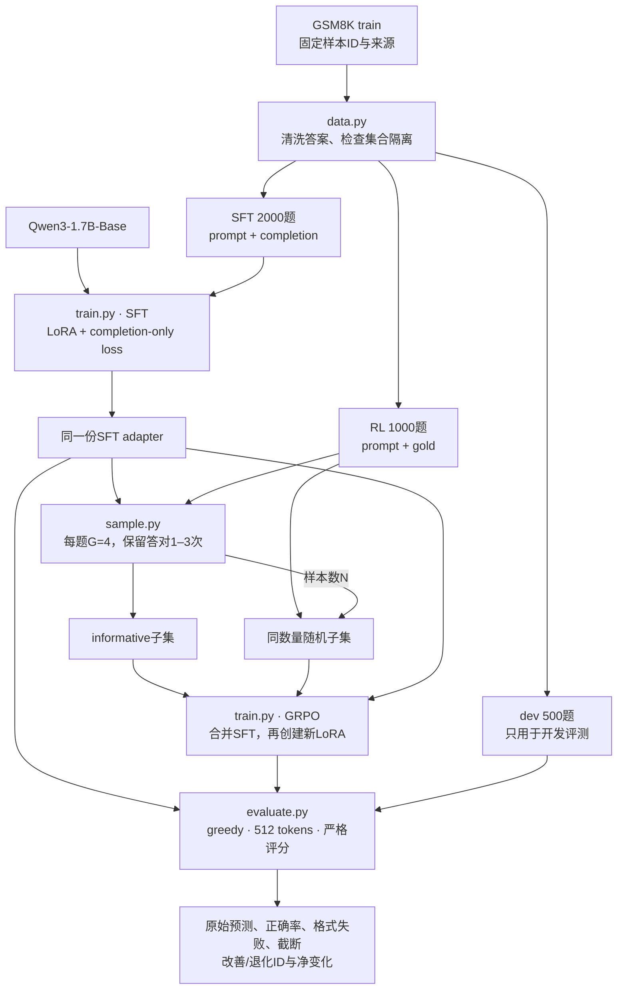

# Qwen GSM8K 数学后训练

基于 **Qwen3-1.7B-Base** 的数学后训练教学项目：使用 LoRA SFT 学习解题与输出格式，再运行 GRPO；提供按 SFT 部分正确率筛选 RL 题目的实验入口。所有日常逻辑集中在五个根目录文件，不再保留多套平台和阶段入口。

**已有结论：SFT 是本实验中主要有效的阶段，两种子 GRPO 的官方测试成绩都低于对应 SFT。** 部分正确题筛选的代码已准备和验证，但尚无真实新训练结果，不能宣称它带来收益。

## 文件结构

本地完整项目位于 `E:/qwen gsm8k`；GitHub 保存源码和轻量评测证据，数据、权重、环境与大型恢复包仅保留本地。

```text
qwen gsm8k/
├── README.md                 项目说明、架构与实验结论
├── 运行命令.md               安装、SFT、筛题、GRPO、评测与续训命令
├── 代码取舍说明.md           旧实现哪些复用、哪些删除及原因
├── data.py                   原始train → SFT/RL/dev
├── train.py                  SFT或GRPO，统一LoRA和Trainer入口
├── sample.py                 每题采样4次，筛出答对1–3次的题
├── evaluate.py               统一dev评测、逐题对照、历史结果核验
├── common.py                 IO、模型合并、生成、严格答案评分
├── prompt.txt                唯一提示词
├── split_manifest.json       固定历史样本ID划分
├── requirements.txt          固定直接依赖版本
├── test_core.py              评分器、数据隔离、筛题与配对测试
├── data/                     本地：SFT2000、RL1000、dev500
├── models/                   本地：完整Base模型（尚未下载）
├── outputs/                  本地：checkpoint、最终adapter、筛题和评测产出
├── logs/                     本地：原始训练日志
├── 历史结果/                 V1/V2预测、报告、冻结清单与来源说明
└── 历史备份/                 本地：迁移回退包、Git bundle、完整checkpoint备份
```

旧 `scripts`、`restart`、`final_grpo` 和 `teaching` 不再作为并列工程。必要逻辑已复用到五个文件；重复评测、平台硬编码、打包解包和一次性制表入口已移除。历史源码通过 Git 的原版本查阅和核验，不在日常目录展开。

## 项目架构



`common.py`统一加载模型、合并 SFT、生成和评分。Gold只用于SFT监督或reward，不能放进生成prompt。评测GRPO时也要先合并**同一份SFT**再加载GRPO adapter，不能直接将它挂到Base。

随机与筛题两组从同一SFT起步，保持样本数、随机种子、更新步数、卡数和超参一致。1/2/3卡的全局completion batch为12，G=4，每update三题。固定步数仍不等于完全匹配题目覆盖和token计算量。

## 如何运行

先阅读[完整运行命令](运行命令.md)。从项目根目录直接运行，不需要进入多层包目录：

```bash
python -m pytest test_core.py -q
python train.py --help
python sample.py --help
python evaluate.py --help

# 对已有两组逐题预测做配对比较
python evaluate.py --before outputs/eval/random.jsonl --after outputs/eval/informative.jsonl --output outputs/eval/paired.json

# 临时读取原Git版本，核验V1/V2冻结证据；不会恢复一套旧工程到工作目录
python evaluate.py --audit-history
```

本地已有SFT adapter在`outputs/sft_full/final_adapter`，其余已保留模型见`outputs/`。完整Base权重需要单独准备。正式环境计划为Linux、Python3.11、Torch2.6.0/cu124、TRL0.24.0，先构建Trainer和20步短跑，再开始正式训练。

## 已完成的实验结论

### V1：SFT有效，GRPO未泛化

下表为已有GSM8K官方test的1319题结果。统一greedy、512 new tokens和严格`Final answer: <number>`协议；格式失败计为错误，截断另行统计。

|模型|正确数 / 1319|严格正确率|错误|格式失败|截断|
|---|---:|---:|---:|---:|---:|
|Base|665|50.42%|264|390|9|
|SFT seed42|902|68.39%|408|9|8|
|GRPO seed42|893|67.70%|413|13|11|
|Extra-SFT对照|898|68.08%|413|8|6|
|SFT seed123|897|68.01%|412|10|6|
|GRPO seed123|882|66.87%|422|15|10|

- SFT seed42相对Base提高17.97个百分点，是本实验主要有效阶段。
- GRPO在dev500的两个seed都提高0.40个百分点，但官方test分别减少9题和15题，下降约0.68和1.14个百分点。
- 两seed平均为SFT 68.20%、GRPO 67.29%，下降约0.91个百分点。两个seed使用同一测试集，不是两份独立测试数据。
- Extra-SFT为68.08%，低于SFT42；其训练计算量与GRPO未严格匹配，不能据此泛化判断方法优劣。

这些是该模型、数据、奖励与训练条件下的描述性结果，不能证明GRPO普遍无效，也不能将小差异直接称为统计显著。

证据：[最终报告](历史结果/reports/final/official_test_report.md)、[逐题转变与核验](历史结果/reports/final/verification.json)、[原始逐题预测](历史结果/results/official_test/)。

### V2：G8相对G4的变化不能称为稳定增益

|配置|dev500|已曝光的official test1319|训练耗时|更新步数|
|---|---:|---:|---:|---:|
|G4 seed42|384/500，76.80%|889/1319，67.40%|3350.71秒|500|
|G8 seed42|378/500，75.60%|898/1319，68.08%|2731.23秒|500|

G8相对G4在test净多9题，但dev净少6题，两者都低于SFT42的902题。每组仅一次运行；改变G会改变题目覆盖，token工作量、平台负载和耗时未严格控制，不能据此宣布稳定提升或加速。V2发生在test曝光后，属于探索，不是新的封存验证。

证据：[V2报告与限制](历史结果/reports/v2/research_report.md)、[压缩逐题结果](历史结果/results/v2/)、[来源清单](历史结果/reports/v2/provenance.json)。

### 已有推理服务测量

历史上在单张T4、FP16、合并SFT模型上做过vLLM合成请求测试：并发1的总输出吞吐约50.12 tokens/s，并发8约273.31 tokens/s。这是服务器聚合吞吐，不是单用户速度；不同随机请求、单次运行，不能作为数学正确率或一般性加速结论。[环境、原始指标与限制](历史结果/reports/final/vllm_benchmark.md)。

## 当前验证范围

- 21项CPU测试通过；数据重建后SFT2000/RL1000/dev500逐条一致，五个冻结最终adapter指纹一致。
- 随机微型Qwen3的SFT单步、prompt loss mask、LoRA变化、SFT合并、新GRPO LoRA、GRPO单步、保存重载与生成通过。微型GRPO全零reward，只验证接口执行，不能证明学习收益。
- 原V1/V2冻结审计通过；必要源码从原Git revision临时读取，原预测、报告和负结果保留。
- 完整1.7B真实采样、新SFT/GRPO、三卡CUDA/DDP及云端版本组合尚未验证，筛题数量和收益未知。
- 历史dev已用于开发，official test已经曝光；新训练先报告探索性dev结论。不能把本次代码整理或smoke测试写成新的模型结果。
