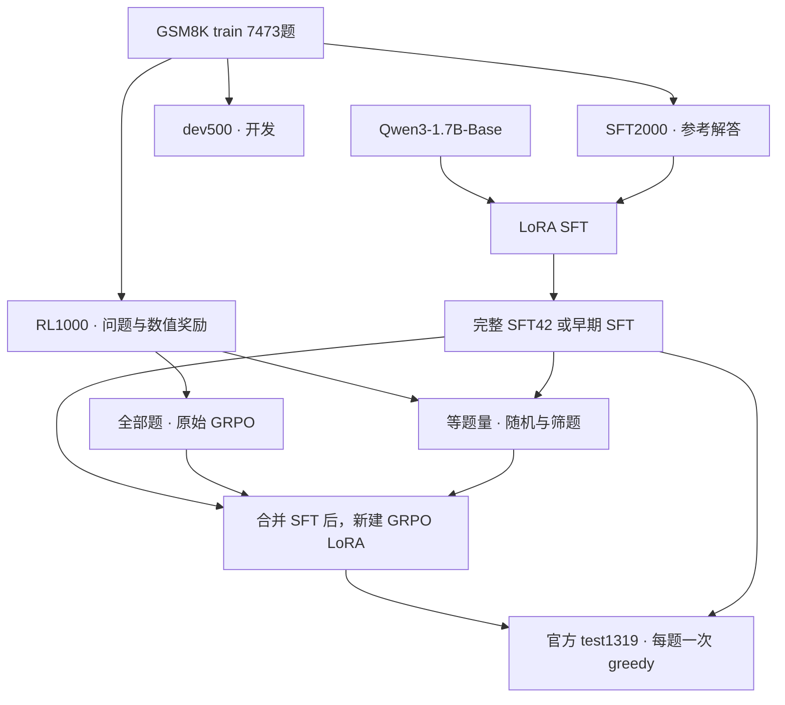

# Qwen3-1.7B · GSM8K 数学后训练

从 Qwen3-1.7B-Base 出发，依次做 LoRA SFT、在线 GRPO 和逐题评测。项目比较完整与早期 SFT 起点、额外监督训练、每题生成数，以及等题量的 GRPO 筛题策略。

## 实验结果

**SFT 带来了最大的提升。** Base 在官方 1,319 题上答对 665 题（50.42%），完整 SFT42 答对 902 题（68.39%），提高 17.97 个百分点。只看过 32 条训练样本的早期 SFT 起点上，两组 GRPO 都有回升，但最终仍低于完整 SFT。两轮等量对照中，筛题都增加了在线混合题组比例，最终正确率都略低于随机组。

各行直接使用保存的官方测试结果，均为每题一次 greedy 生成、最多 512 个新 token，以严格 `Final answer: <number>` 判分。格式失败计为错误。历史 V1 在冻结后评测，后续探索复用同一已曝光测试集。

| 实验 | 模型或配置 | 答对 / 1,319 | 严格正确率 | 相对自己的 SFT 起点 |
| --- | --- | ---: | ---: | ---: |
| V1 | Qwen3-1.7B-Base | 665 | 50.42% | — |
| V1 | 完整 SFT42 | 902 | 68.39% | — |
| V1 | SFT42 → 原始 GRPO | 893 | 67.70% | −9 |
| V1 | SFT42 → Extra-SFT | 898 | 68.08% | −4 |
| V1 | 完整 SFT123 | 897 | 68.01% | — |
| V1 | SFT123 → 原始 GRPO | 882 | 66.87% | −15 |
| V2 | SFT42 → G4 GRPO | 889 | 67.40% | −13 |
| V2 | SFT42 → G8 GRPO | 898 | 68.08% | −4 |
| 等量筛题 | 完整 SFT42 → 随机 GRPO | **904** | **68.54%** | +2 |
| 等量筛题 | 完整 SFT42 → 筛题 GRPO | 896 | 67.93% | −6 |
| 冷启动 | 早期 SFT，第 2 步（32 条样本） | 855 | 64.82% | — |
| 冷启动 | 第 2 步 SFT → 随机 GRPO | 872 | 66.11% | +17 |
| 冷启动 | 第 2 步 SFT → 筛题 GRPO | 870 | 65.96% | +15 |

相对起点的变化按答对题数计算。完整 SFT42 在表中同时是 V1 产物及后续几轮的共同起点。前三轮探索的详细资产、解码记录和原始指标保留在各自报告中。

### 原始 GRPO、Extra-SFT 与 G4/G8

原始 GRPO 的两个种子在 dev500 各多答对 2 题（+0.40 个百分点），在官方 test 各少答对 9、15 题。Extra-SFT 把同一批 RL1000 的参考解答转成监督样本，从完整 SFT42 再训一遍，官方 test 少答对 4 题。它与 GRPO 的计算预算不同。V2 从同一 SFT42 出发各更新 500 步，G8 比 G4 在 test 多答对 9 题，在 dev 少答对 6 题，两者的 test 均低于 SFT42。

[原始评测与双种子报告](历史结果/reports/final/official_test_report.md) · [Extra-SFT](历史结果/reports/day14/extra_sft_control.md) · [G4/G8 对照](历史结果/reports/v2/research_report.md)

开发集消融只使用 dev500。原始 GRPO 的 250、500、750、1,000 步 checkpoint 分别为 75.80%、77.20%、77.00%、78.40%；KL 系数 0.02、0.04、0.08 分别为 77.20%、78.40%、76.20%；学习率 5e-7、1e-6、2e-6 分别为 75.40%、78.40%、77.40%。这些配置用于开发比较，官方测试表只列实际执行过 test1319 的模型。[开发集消融报告](历史结果/reports/ablation/grpo_hyperparameter_ablation.md)

### 完整 SFT 与早期 SFT 的筛题对照

两轮均从同一题源 RL1000 取样，两组各训练 476 道、各两轮。随机组复用同一份 476 题名单。筛题组从对应冻结 SFT 每题采四条、答对 1–3 条的题中选取。在线训练仍会重新生成回答。

| 指标 | 完整 SFT42 起点 | 第 2 步 SFT 起点 |
| --- | ---: | ---: |
| 训前 RL1000 混合题 | 476 | 632 |
| 在线混合组，随机组 | 459/952（48.21%） | 609/952（63.97%） |
| 在线混合组，筛题组 | 623/952（65.44%） | 678/952（71.22%） |
| 筛题组 − 随机组，官方 test | −8 题（−0.61 个百分点） | −2 题（−0.15 个百分点） |

从第 2 步 SFT 出发，随机组比自己的起点多答对 17 题，筛题组多答对 15 题。早期起点的回升幅度大于完整起点那轮的历史变化，但表现更好的早期随机组仍比完整 SFT42 少答对 30 题。筛题的相对劣势从 8 题缩至 2 题，差值变化为 6 题（0.45 个百分点）。第 2 步下，筛题组相对随机组新做对 45 题、丢了 47 题。两轮是单种子探索，结果没有确立弱起点能普遍增强 GRPO，也没有观察到筛题胜过随机。

早期 SFT 第 32、8、2 步分别处理了 512、128、32 条样本。训前采样的混合题从 488 增至 521、632；第 2 步有 593/4,000 条格式失败，完整 SFT42 是 37/4,000。混合题增加与答案格式和数值解答共同变化，不能单独解释为更强的推理训练信号。第 32 步的两组 GRPO 提前停止，第 8 步只完成筛题。只有第 2 步早期起点完成了两组训练和终评。预留的 500 题未执行评测。

[完整 SFT 筛题实验](历史结果/grpo_screening_4090/README.md) · [冷启动实验、逐题证据和归档](历史结果/grpo_coldstart_4090/README.md)

## 训练链路



SFT 只对参考解答部分计算损失。GRPO 给当前模型同题多条回答打二值奖励，再利用组内差异更新。筛题时的回答只用于选题。本项目保留题号、提示词和权重指纹，以便按题复核。

## 阅读代码与复现

| 顺序 | 文件 | 主要用途 |
| --- | --- | --- |
| 1 | `data.py`、`split_manifest.json`、`prompt.txt` | 构建互不重叠的 SFT2000、RL1000、dev500，固定题号和输出格式 |
| 2 | `common.py`、`train.py` | 评分、模型加载与合并、SFT 和原始 GRPO |
| 3 | `sample.py`、`evaluate.py` | 筛题、开发集评测和历史证据核验 |
| 4 | `train_grpo_experiment.py`、`screen12.py`、`train_b8.py`、`eval_test_b8.py` | 完整 SFT 起点的单卡对照入口 |
| 5 | `coldstart.py` | 早期 SFT、批量筛题、两组在线 GRPO、终评和配对比较 |

```text
qwen_gsm8k/
├── README.md
├── 运行命令.md / coldstart.md
├── data.py / common.py / train.py / sample.py / evaluate.py
├── train_grpo_experiment.py / screen12.py / train_b8.py / eval_test_b8.py / coldstart.py
├── 历史结果/
│   ├── reports/、results/      V1/V2 结果与冻结报告
│   ├── grpo_screening_4090/   完整 SFT 对照
│   └── grpo_coldstart_4090/   早期 SFT 对照
├── data/                    本地生成的数据
├── outputs/                 本地权重、训练产出和云端归档
└── 历史备份/                 历史权重与完整版本备份
```

- [数据、环境与原始训练命令](运行命令.md) · [冷启动复现与已有权重评测](coldstart.md)
- [代码整理取舍](代码取舍说明.md) · [早期实验设计与入口](阅读顺序与GRPO实验设计.md)
- [T4 推理记录](历史结果/reports/final/vllm_benchmark.md)（合成请求，并发 1 和 8 的聚合输出分别为约 50.12 与 273.31 tokens/s）

GitHub 保存源码、汇总和轻量逐题证据。模型权重、完整生成文本和恢复包保留在本地。旧结果可以用 `python evaluate.py --audit-history` 核验；CPU 测试运行 `python -m pytest test_core.py test_grpo_experiment.py -q`。
