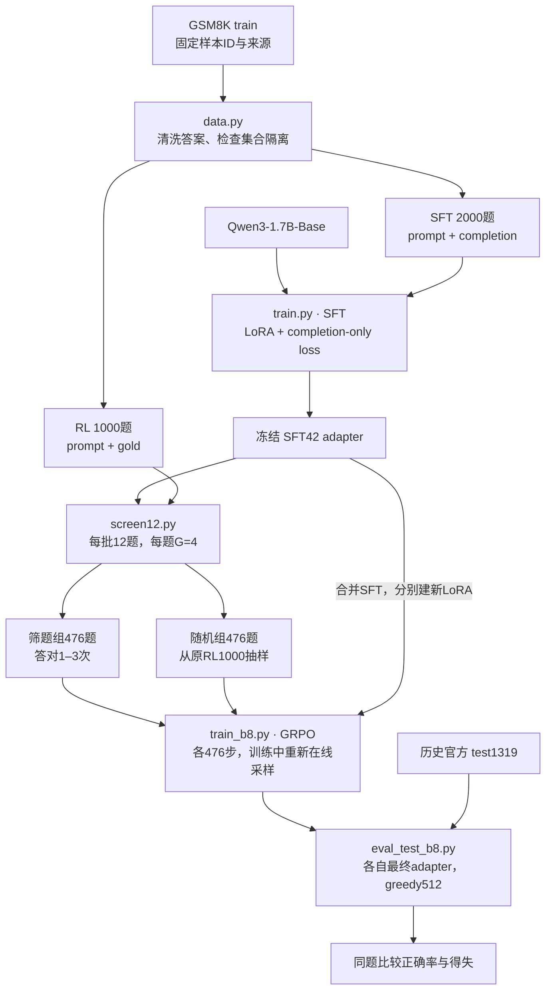

# Qwen GSM8K 数学后训练

基于 **Qwen3-1.7B-Base** 的数学后训练教学项目。使用 LoRA SFT 学习解题与输出格式，再运行 GRPO。根目录同时提供原训练流程与单卡同题量筛题实验入口。

## 今日结论 · 2026-11-18

**筛题提高了训练中的混合组比例。这次官方测试中，筛题组比同题量随机组少答对 8 题。**

单卡 RTX 4090 上，两组分别使用 476 道题，从同一份 SFT42 出发，各训练 476 步（2 epoch）。筛题组保留冻结 SFT 每题采样四次时答对 1～3 次的题。训练期间，组内既有正确回答又有错误回答的题组记为混合组。

|指标|随机组|筛题组|筛题组 − 随机组|
|---|---:|---:|---:|
|训练期间的混合组比例|459/952（48.21%）|623/952（65.44%）|+17.23 个百分点|
|历史官方 test1319 正确率|904/1319（68.54%）|896/1319（67.93%）|−8 题（−0.61 个百分点）|

逐题比较随机组和筛题组，筛题组新增答对 31 题，同时失去 39 道随机组答对的题。其中 37 题变为数值错误、2 题变为格式失败。混合组比例的差距在两个 epoch 都存在，随机组为 47.69% 和 48.74%，筛题组为 62.61% 和 68.28%。[完整配置、逐题对照与在线统计](历史结果/grpo_screening_4090/README.md)

### 用历史 SFT42 逐题定位分差

将历史 SFT42 的预测与本轮两组的预测按题号、标准答案对齐。历史 SFT42 答对 902 题，答错 417 题。

|相对历史 SFT42|随机组|筛题组|筛题组 − 随机组|
|---|---:|---:|---:|
|历史答错、本轮答对|35|38|+3|
|历史答对、本轮答错|33|44|多丢 11 题|
|正确题数净变化|+2|−6|−8|

**筛题组多改对了 3 道历史错题，也多丢了 11 道历史对题。** 两组共享 228 道训练题。随机组独有的 248 题在冻结 SFT 筛题时是 206 题全对、42 题全错。筛题组用 248 道混合题替换了这些题，改变了训练覆盖。这是可检验的解释之一，当前单种子对照无法确认它造成了丢分。[历史 SFT42 逐题预测](历史结果/results/official_test/sft_seed42_test1319.jsonl) · [本轮逐题判定](历史结果/grpo_screening_4090/test_outcomes.csv)

核验确认 SFT42 adapter、测试题和提示词哈希一致，两次均使用 greedy 和 512 tokens 上限。历史评测每次处理 1 题，本轮每次处理 16 题。历史 Kaggle 记录只留下 Base 路径，缺少实际加载文件的哈希。因此历史 SFT42 适合定位逐题分差，严格同条件下相对本轮 SFT 起点的净收益仍未测定。两组 A/B 使用本轮同一套资产和设置，结论限于 seed42 和已曝光的官方测试集。[历史评测汇总](历史结果/results/official_test/sft_seed42_test1319_summary.json) · [本轮实验汇总](历史结果/grpo_screening_4090/summary.json)

## 实验流程



`common.py`统一加载模型、合并 SFT、生成和评分。Gold只用于SFT监督或reward，不能放进生成prompt。评测GRPO时也要先合并**同一份SFT**再加载GRPO adapter，不能直接将它挂到Base。

图中是这次实际执行的单卡实验。两组训练微批都是 8 条回答、梯度累积 1，每次更新用 2 道题。评测微批是 16 道题，每题生成一条回答。dev500 仍可用于开发，这次两组直接测试了预定第 476 步的最终 adapter。固定步数约束了更新预算，各组实际题目覆盖和生成 token 数可以不同。

## 文件结构

本地完整项目位于 `E:/qwen_gsm8k`。GitHub 保存源码和轻量评测证据，权重、环境与大型恢复包保留在本地。

```text
qwen_gsm8k/
├── README.md                 项目说明、架构与实验结论
├── 运行命令.md               安装、SFT、筛题、GRPO、评测与续训命令
├── 代码取舍说明.md           旧实现哪些复用、哪些删除及原因
├── data.py                   原始train → SFT/RL/dev
├── train.py                  SFT或GRPO，统一LoRA和Trainer入口
├── sample.py                 每题采样4次，筛出答对1–3次的题
├── evaluate.py               统一dev评测、逐题对照、历史结果核验
├── common.py                 IO、模型合并、生成、严格答案评分
├── train_grpo_experiment.py   GRPO 对照训练及统计
├── screen12.py / train_b8.py / eval_test_b8.py  单卡实跑入口
├── prompt.txt                唯一提示词
├── split_manifest.json       固定历史样本ID划分
├── requirements.txt          固定直接依赖版本
├── test_core.py              评分器、数据隔离、筛题与配对测试
├── data/                     本地：SFT2000、RL1000、dev500
├── models/                   本地：完整Base模型（尚未下载）
├── outputs/                  本地：checkpoint、最终adapter、筛题和评测产出
├── logs/                     本地：原始训练日志
├── 历史结果/                 V1/V2 证据、单卡筛题结果与冻结清单
└── 历史备份/                 本地：迁移回退包、Git bundle、完整checkpoint备份
```

旧 `scripts`、`restart`、`final_grpo` 和 `teaching` 不再作为并列工程。必要逻辑已复用到五个文件；重复评测、平台硬编码、打包解包和一次性制表入口已移除。历史源码通过 Git 的原版本查阅和核验，不在日常目录展开。

## 如何运行

复现本次单卡对照，先看[实跑命令和资产要求](历史结果/grpo_screening_4090/README.md#实际配置)。原项目的安装、SFT 和通用训练入口见[完整运行命令](运行命令.md)。从项目根目录执行以下命令可以检查入口与历史证据。

```bash
python -m pytest test_core.py test_grpo_experiment.py -q
python train.py --help
python sample.py --help
python evaluate.py --help

# 对 evaluate.py 生成且附带运行元数据的开发集预测做配对比较
python evaluate.py --before outputs/eval/random.jsonl --after outputs/eval/informative.jsonl --output outputs/eval/paired.json

# 临时读取原Git版本，核验V1/V2冻结证据；不会恢复一套旧工程到工作目录
python evaluate.py --audit-history
```

已有 SFT42 adapter 在本地 `outputs/sft_full/final_adapter`，完整 Base 权重需单独准备。本次云端实际使用 PyTorch `2.6.0+cu126`、TRL `0.24.0`，完整环境版本见[实验汇总](历史结果/grpo_screening_4090/summary.json)。

## 历史实验结论

### V1：SFT有效，GRPO未泛化

下表为已有GSM8K官方test的1319题结果。统一greedy、512 new tokens和严格`Final answer: <number>`协议；格式失败计为错误，截断另行统计。

|模型|正确数 / 1319|严格正确率|错误|格式失败|截断|
|---|---:|---:|---:|---:|---:|
|Base|665|50.42%|264|390|9|
|SFT seed42|902|68.39%|408|9|8|
|GRPO seed42|893|67.70%|413|13|11|
|Extra-SFT对照|898|68.08%|413|8|6|
|SFT seed123|897|68.01%|412|10|6|
|GRPO seed123|882|66.87%|422|15|10|

- SFT seed42相对Base提高17.97个百分点，是本实验主要有效阶段。
- GRPO在dev500的两个seed都提高0.40个百分点，但官方test分别减少9题和15题，下降约0.68和1.14个百分点。
- 两seed平均为SFT 68.20%、GRPO 67.29%，下降约0.91个百分点。两个seed使用同一测试集，不是两份独立测试数据。
- Extra-SFT为68.08%，低于SFT42；其训练计算量与GRPO未严格匹配，不能据此泛化判断方法优劣。

这些是该模型、数据、奖励与训练条件下的描述性结果，不能证明GRPO普遍无效，也不能将小差异直接称为统计显著。

证据：[最终报告](历史结果/reports/final/official_test_report.md)、[逐题转变与核验](历史结果/reports/final/verification.json)、[原始逐题预测](历史结果/results/official_test/)。

### V2：G8相对G4的变化不能称为稳定增益

|配置|dev500|已曝光的official test1319|训练耗时|更新步数|
|---|---:|---:|---:|---:|
|G4 seed42|384/500，76.80%|889/1319，67.40%|3350.71秒|500|
|G8 seed42|378/500，75.60%|898/1319，68.08%|2731.23秒|500|

G8相对G4在test净多9题，但dev净少6题，两者都低于SFT42的902题。每组仅一次运行；改变G会改变题目覆盖，token工作量、平台负载和耗时未严格控制，不能据此宣布稳定提升或加速。V2发生在test曝光后，属于探索，不是新的封存验证。

证据：[V2报告与限制](历史结果/reports/v2/research_report.md)、[压缩逐题结果](历史结果/results/v2/)、[来源清单](历史结果/reports/v2/provenance.json)。

### 已有推理服务测量

历史上在单张T4、FP16、合并SFT模型上做过vLLM合成请求测试：并发1的总输出吞吐约50.12 tokens/s，并发8约273.31 tokens/s。这是服务器聚合吞吐，不是单用户速度；不同随机请求、单次运行，不能作为数学正确率或一般性加速结论。[环境、原始指标与限制](历史结果/reports/final/vllm_benchmark.md)。

## 当前验证范围

- 28 项 CPU 测试通过。数据重建后 SFT2000、RL1000、dev500 逐条一致，五个历史冻结最终 adapter 指纹一致。
- 随机微型Qwen3的SFT单步、prompt loss mask、LoRA变化、SFT合并、新GRPO LoRA、GRPO单步、保存重载与生成通过。微型GRPO全零reward，只验证接口执行，不能证明学习收益。
- 原V1/V2冻结审计通过；必要源码从原Git revision临时读取，原预测、报告和负结果保留。
- 2026-11-18 已完成 1.7B 单卡 4090 的筛题和两组 GRPO 训练与评测。三卡 CUDA/DDP 仍未在真实 GPU 上验证。
- 历史 dev 已用于开发，官方 test 已曝光。本次是预定最终权重在历史题集上的探索性对照。
